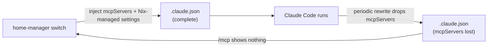

# MCP Server Troubleshooting Guide

## Overview

MCP (Model Context Protocol - the open protocol Claude Code uses to talk to external tool servers) servers in this repository are declared in Nix and written into Claude Code's config on every `home-manager switch`. Most problems trace back to one fact: Claude Code owns and periodically rewrites its `.claude.json` at runtime, so Nix-managed state (including the `mcpServers` list) can be silently dropped between switches. This guide is symptom-first - start at the triage table, jump to the matching issue, and apply the fix. For how the Claude Code module fits into the wider configuration, see [`docs/ARCHITECTURE.md`](./ARCHITECTURE.md) and the module source at [`modules/programs/claude-code/claude-code.nix`](../modules/programs/claude-code/claude-code.nix).

## Symptom triage

| What you see | Likely cause | Go to |
|---|---|---|
| `/mcp` lists no servers | Claude Code overwrote `.claude.json` and dropped `mcpServers` | [Issue 1](#issue-1-mcp-servers-not-showing-in-mcp-command) |
| `sequential-thinking-mcp: command not found` | Wrapper script not installed | [Issue 2](#issue-2-sequential-thinking-server-not-found) |
| Context7 errors or never appears | `npx` / Node.js unavailable | [Issue 3](#issue-3-context7-fails-to-start) |
| CLI server cannot access a directory | `ALLOWED_DIR` too narrow | [Issue 4](#issue-4-cli-mcp-server-permission-errors) |

## Quick Diagnostics

### 1. Check if MCP servers are visible in Claude Code
```bash
# For Pro account
CLAUDE_CONFIG_DIR="/home/tim/.claude-pro" claudepro --print "/mcp"

# For Max account  
CLAUDE_CONFIG_DIR="/home/tim/.claude-max" claudemax --print "/mcp"
```

### 2. Verify MCP server configuration files
```bash
# Check settings.json (should have mcpServers)
cat ~/.claude-pro/settings.json | jq '.mcpServers'

# Check .claude.json (may have mcpServers or null)
cat ~/.claude-pro/.claude.json | jq '.mcpServers'
```

### 3. Test individual MCP servers
```bash
# Test sequential-thinking wrapper
which sequential-thinking-mcp

# Test context7
npx -y @upstash/context7-mcp --help

# Test CLI server path
ls -la /nix/store/*cli-mcp-server*/bin/
```

## Common Issues and Solutions

### Issue 1: MCP servers not showing in /mcp command
**Symptoms**: Running `/mcp` in Claude Code shows no servers or empty list

**Root Cause**: Claude Code periodically overwrites `.claude.json`, removing `mcpServers`

**Permanent Fix**:
The home-manager activation script automatically replaces MCP servers and all Nix-managed settings on every `home-manager switch`. Simply run:
```bash
home-manager switch --flake '.#tim@thinky-nixos'
```

This enforces:
- mcpServers (MCP server configurations)
- permissions (allow/deny security rules)
- env (environment variables)
- statusLine (custom statusline configuration)
- hooks (automation hooks)

**Manual Fix (if needed immediately)**:
```bash
# Re-inject MCP servers into .claude.json
cat ~/.claude-pro/.claude.json | jq '. + {
  "mcpServers": {
    "cli-mcp-server": {
      "args": [],
      "command": "/nix/store/gf9qmzr5m8mpis8m6rzydc9dqby8l9d5-cli-mcp-server-env/bin/cli-mcp-server",
      "env": {"ALLOWED_DIR": "/tmp", "DEBUG": "", "NODE_ENV": "production"},
      "retries": 3,
      "timeout": 300
    },
    "context7": {
      "args": ["-y", "@upstash/context7-mcp"],
      "command": "npx",
      "env": {"DEBUG": "", "NODE_ENV": "production"},
      "retries": 3,
      "timeout": 300
    },
    "sequential-thinking": {
      "args": [],
      "command": "sequential-thinking-mcp",
      "env": {"DEBUG": "", "NODE_ENV": "production"},
      "retries": 3,
      "timeout": 600
    }
  }
}' > ~/.claude-pro/.claude.json.tmp && mv ~/.claude-pro/.claude.json.tmp ~/.claude-pro/.claude.json
```

### Issue 2: Sequential-thinking server not found
**Symptoms**: Error about sequential-thinking-mcp command not found

**Check**:
```bash
# Verify wrapper script installed
which sequential-thinking-mcp
ls -la ~/.nix-profile/bin/sequential-thinking-mcp

# Check if Python environment is correct
/nix/store/*sequential-thinking*/bin/python -c "import sequential_thinking_mcp"
```

**Fix**: Run `home-manager switch` to ensure wrapper script is installed

### Issue 3: Context7 fails to start
**Symptoms**: Context7 MCP server errors or doesn't appear

**Check**:
```bash
# Test npx availability
npx -y @upstash/context7-mcp --version

# Check npm/node installation
which npm
which node
```

**Fix**: Ensure nodejs is in system packages or home.packages

### Issue 4: CLI MCP server permission errors
**Symptoms**: CLI server can't access directories

**Check**:
```bash
# Verify ALLOWED_DIR is set correctly
cat ~/.claude-pro/settings.json | jq '.mcpServers."cli-mcp-server".env.ALLOWED_DIR'
```

**Fix**: Update ALLOWED_DIR in the Nix configuration to include needed paths

## File Locations

### Configuration Files
- **Settings**: `~/.claude-{pro,max}/settings.json` - User-editable settings
- **Runtime State**: `~/.claude-{pro,max}/.claude.json` - Claude Code runtime data (volatile!)
- **Memory**: `~/src/nixcfg/claude-runtime/.claude-{pro,max}/CLAUDE.md` - Global memory
- **MCP Template**: Generated by Nix in `/nix/store/*/claude-settings.json`

### Log Files
- **Claude Code logs**: `~/.claude-{pro,max}/logs/`
- **MCP server logs**: Check individual server documentation
- **Activation logs**: Run `home-manager switch` with `--verbose`

## Configuration Hierarchy

Claude Code reads configuration from several files; higher-priority sources win when they define the same key.

| Priority | File | Role | Notes |
|---|---|---|---|
| 1 (highest) | `.claude.json` | Runtime state and configuration | Volatile - Claude Code overwrites it (see [Issue 1](#issue-1-mcp-servers-not-showing-in-mcp-command)) |
| 2 | `settings.json` | User settings | Nix-managed; safe to edit for runtime tweaks |
| 3 | `mcp.json` | Legacy MCP configuration | Deprecated |
| 4 | `.claude/settings.json` | Project overrides | Lives in the project root |

**Important**: `.claude.json` is volatile and gets overwritten by Claude Code, which is why the activation script re-applies Nix-managed settings on every switch.

## Testing MCP Servers

### Manual Server Test
```bash
# Test sequential-thinking directly
echo '{"jsonrpc":"2.0","method":"initialize","params":{"capabilities":{}},"id":1}' | sequential-thinking-mcp

# Test context7
echo '{"jsonrpc":"2.0","method":"initialize","params":{"capabilities":{}},"id":1}' | npx -y @upstash/context7-mcp
```

### Debug Mode
Enable debug output by setting in settings.json:
```json
{
  "mcpServers": {
    "your-server": {
      "env": {
        "DEBUG": "1"
      }
    }
  }
}
```

## Recovery Procedures

### Full Reset
```bash
# Backup current state
cp -r ~/.claude-pro ~/.claude-pro.backup

# Remove all configuration
rm -rf ~/.claude-pro

# Rebuild from Nix
home-manager switch

# Restart Claude Code
```

### Selective Fix
```bash
# Just fix MCP servers
home-manager switch

# Re-inject MCP config (use script from Issue 1 above)

# Restart Claude Code or reload window
```

## Architecture Notes

### Why MCP servers disappear

Claude Code and the Nix activation script both write `.claude.json`. Claude Code's rewrites drop the `mcpServers` section; the activation script puts it back on the next switch, while preserving the runtime data (OAuth, projects) that only Claude Code knows.



### Design Decisions
- **Wrapper scripts**: Avoid Python package conflicts
- **Direct store paths**: Ensure reproducible server locations  
- **Separate accounts**: Enable concurrent Pro/Max sessions
- **Settings.json preservation**: Allow runtime modifications

## Future Improvements

The activation script already replaces all Nix-managed settings while preserving runtime data, which resolves the disappearing-server problem. Remaining ideas, none currently required:

- **Optional**: A systemd timer for additional robustness (not needed with the current solution)
- **Optional**: Hook system integration (unnecessary complexity today)
- **Upstream**: Request that Claude Code preserve `mcpServers` across its own `.claude.json` writes

## Implementation Notes

### Why Replacement Not Merge?
The activation script uses **replacement** (`jq '.mcpServers = $value'`) rather than **merge** (`jq '. + {...}'`) for Nix-managed settings. This ensures:
- Removed MCP servers are actually deleted
- Changed configurations take effect immediately
- No stale settings persist from previous configurations

### Safe JSON Handling
The script uses `jq --argjson` to safely pass JSON with special characters:
```bash
jq --argjson mcpServers '${builtins.toJSON cfg.mcpServers}' '.mcpServers = $mcpServers'
```
This handles parentheses, wildcards, and other special characters in permissions and other settings.

## Related Documentation

- [`CLAUDE.md`](../CLAUDE.md) - Main project configuration and session workflow
- [`modules/programs/claude-code/claude-code.nix`](../modules/programs/claude-code/claude-code.nix) - Nix module implementation
- `claude-runtime/.claude-{pro,max}/CLAUDE.md` - Account-specific memory (Nix build output)
- [Model Context Protocol documentation](https://modelcontextprotocol.io/) - Upstream MCP specification