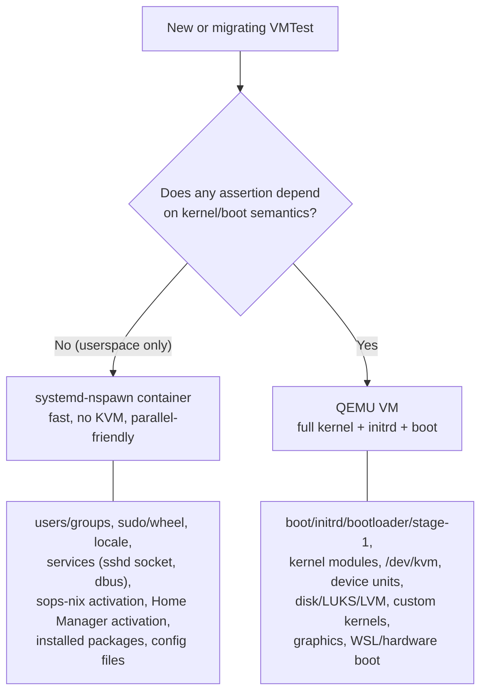

# systemd-nspawn Container Test Backend (NixOS 26.05)

A practical guide to running NixOS integration tests on the **systemd-nspawn container
backend** instead of QEMU virtual machines (VMs): when to use it, the host prerequisites, how to write a new
container test, how to migrate an existing VM test, and the **real, verified constraints and
caveats** discovered doing exactly that in this repo. (QEMU is the full-machine-emulation backend the NixOS test framework uses by default; a container shares the host kernel instead of booting its own.)

> The backend is proven working on this repo's current pin (nixos-unstable >= 2026-05, which already ships the 26.05 nspawn test-driver backend). See the "Verified vs open" section at the end for what is empirically confirmed vs still inferred. This backend was introduced during the NixOS 26.05 uplift.

## Why (the payoff)

An nspawn container shares the host kernel instead of booting a full VM. Measured on this host
with an **identical** config (`system-cli` module + identical assertions), container vs QEMU:

| Metric | QEMU (`vm-system-type-cli`) | nspawn (`vm-nspawn-smoke`) | Speedup |
|---|---|---|---|
| Boot to `multi-user.target` | 24.38s | **4.66s** | ~5.2x |
| Test script total | 24.94s | **3.75s** | ~6.6x |
| QEMU "connecting" alone | 16.50s | ~0 | - |

The container ran the whole smoke faster than QEMU took just to connect. Because containers use far less RAM than VMs, you can also run many more in parallel - the point of migrating: cheap, fast test coverage across all hosts.

## When to use a container vs a VM (eligibility)

The decision reduces to one question: does any assertion depend on something *below* userspace? If no, it is a container candidate; if yes, it stays on QEMU.



A container **shares the host kernel** - there is no initrd, no bootloader, no stage-1 systemd, no kernel modules, no KVM. Only userspace systemd runs.

**Use a container** when the test only exercises userspace: users/groups, `sudo`/wheel, locale, services (sshd, dbus, sops-nix activation), Home Manager activation, installed packages, config files. This is the large majority of integration tests.

**Keep QEMU** when the test's *meaning* depends on kernel/boot semantics:
- Boot/initrd/bootloader/stage-1 behavior (e.g. "does a minimal config *boot*?" - a container
  reaching `multi-user.target` does **not** prove a bootable system).
- Kernel modules, `/dev/kvm`, device units, disk/LUKS/LVM, custom kernels.
- WSL- or hardware-specific boot behavior.

If unsure, classify by asking: "does any assertion depend on something below userspace?" If no,
it's a container candidate.

## Host prerequisites (the builder must grant `uid-range` + `cgroups`)

An nspawn container-test run derivation carries `requiredSystemFeatures = [ "uid-range" ]` and
the driver places the container in a cgroup. The **builder** must therefore have, in its Nix
config:

```nix
# modules/system/types/1-minimal/minimal.nix (NixOS block) - already enabled fleet-wide
nix.settings = {
  experimental-features = [ "nix-command" "flakes" "auto-allocate-uids" "cgroups" ];
  auto-allocate-uids = true;               # lets a build request a transient uid range
  extra-system-features = [ "uid-range" ]; # advertise it (append-safe; keeps kvm/nixos-test)
};
```

Three things are required, and all three were needed in practice - enabling only
`auto-allocate-uids` is **not** sufficient:
1. `auto-allocate-uids` experimental feature **and** setting = `true` (transient uid range).
2. `cgroups` experimental feature (else the run fails: *"experimental Nix feature 'cgroups' is
   disabled"*).
3. `uid-range` advertised in the builder's system features (via `extra-system-features`, which
   appends rather than clobbering the auto-detected `kvm`/`nixos-test`).

This is enabled fleet-wide in this repo's base module, so **every NixOS host and any CI runner
built from it** can run nspawn tests **after a `nixos-rebuild switch`** picks up the config.

### Running one right now without a rebuild (ad hoc / CI-runner setup)

You can supply the settings to a one-off build as root, bypassing the daemon (which ignores
client-side experimental-feature overrides). Use `NIX_CONFIG` (file-style) - command-line
`--option`/`--extra-experimental-features` flags do **not** work here (parse order: the
`auto-allocate-uids` *setting* is validated before the *feature* is active):

```bash
sudo env NIX_CONFIG=$'experimental-features = nix-command flakes auto-allocate-uids cgroups\nauto-allocate-uids = true\nextra-system-features = uid-range' \
  nix build '.#checks.x86_64-linux.vm-nspawn-smoke' --store local --no-write-lock-file -L
```

`--store local` makes the invoking (root) nix the builder so it applies these settings; without
it the request goes to the daemon, whose config is unchanged until a rebuild.

## Writing a new container test

Use the `mkContainerTest` helper in `modules/flake-parts/vm-tests.nix`. It wraps
`pkgs.testers.runNixOSTest` and places the machine under `containers.<name>`.

```nix
vm-my-smoke = mkContainerTest {
  name = "my-smoke";
  description = "…";
  modules = [ self.modules.nixos.system-cli ];   # compose dendritic modules, not host configs
  extraConfig = { systemDefault.userName = testUsername; };
  testScript = ''
    machine.wait_for_unit("multi-user.target")
    machine.succeed("id ${testUsername}")
    machine.succeed("git --version")
  '';
};
```

**Why not `mkVmTest`?** `mkVmTest` wraps `pkgs.testers.nixosTest` - the *legacy*
`simpleTest`/`testing-python.nix` path, which has **no `containers` option**. The nspawn backend
lives only on `pkgs.testers.runNixOSTest` (the module-based `nixos/lib/testing/` framework), where
a top-level `containers.<name>` attr sits alongside `nodes.<name>` and `allMachines` merges both
(name-collision-guarded).

## Migrating an existing VM test

The Python `testScript` does **not** change - machine names persist via `allMachines`. The edit
is infrastructure-only:

1. Switch the helper: `mkVmTest { ... }` to `mkContainerTest { ... }` (or, for a hand-rolled
   `pkgs.testers.nixosTest { nodes.machine = ...; }`, use
   `pkgs.testers.runNixOSTest { containers.machine = ...; }`).
2. Move each machine from `nodes.<n>` to `containers.<n>`.
3. Drop `virtualisation.memorySize` / `virtualisation.*` (QEMU-only; meaningless for containers).
4. Re-check service-state assertions against the caveats below (this is where migrations bite).

## Constraints & caveats (VERIFIED in this repo)

These are real differences observed while migrating, not theory:

- **Service *units* can differ - sshd is the canonical example (ROOT-CAUSED, VERIFIED).**
  `vm-nspawn-smoke` initially failed on `wait_for_unit("sshd.service")`. Instrumenting the container
  (`systemctl is-enabled sshd.service` -> `not-found`; `systemctl list-units '*ssh*'`) showed **there
  is no `sshd.service` at all** in the container - instead `sshd.socket` (plus `sshd-unix-*.socket`)
  is **active and listening**, generated by **`systemd-ssh-generator`** (a systemd >=256 feature that
  ships in 26.05). So ssh is **socket-activated**, and *not* because of NixOS `startWhenNeeded`
  (which `system-cli` leaves `false`) - it is the systemd generator, and here it manifests only in
  the container. The identical QEMU twin still instantiates a real, running `sshd.service`. **Lesson:**
  do not assume a `wait_for_unit("<svc>.service")` that passes under QEMU passes under nspawn - the
  unit may not exist. Assert the **socket** (`wait_for_unit("sshd.socket")` / `wait_for_open_port(22)`)
  and/or an activation-agnostic artifact (`test -f /etc/ssh/ssh_host_ed25519_key`). `vm-nspawn-smoke`
  now does exactly this.
- **Networking IS provided by the test framework (corrects an earlier wrong claim).** The container is
  started with `--private-network` (its own netns), but the NixOS test driver's `nixos/lib/testing/
  network.nix` then wires interfaces in - a single-container test still comes up with a real NIC
  (observed: `eth1: 192.168.1.1/24`, `2001:db8:1::1/64`), and multi-container tests get veth/bridge
  links between machines. It is **not** loopback-only. What differs from a VM is *how* the topology is
  built (netns + veth/bridge vs emulated NICs) and the fidelity limits below - not the presence of
  networking. See "Networking capabilities & fidelity" for what you can and cannot model.
- **No `virtualisation.*` options.** `memorySize`, `cores`, disk images, etc. simply don't apply.
- **Boot semantics are absent by definition.** Reaching `multi-user.target` proves userspace came
  up, **not** that the system boots. Keep boot-smoke tests on QEMU.
- **Builder features are per-runner.** A runner without `auto-allocate-uids`+`cgroups`+`uid-range`
  cannot *build* a container test (it fails with "missing system features: uid-range"). Under
  `nix flake check --no-build` the check still **evaluates** fine - the requirement bites only at
  build time. Keep container tests out of a CI matrix until that runner is configured.
- **Home Manager activation RUNS on nspawn via a read-only-store recipe (ROOT-CAUSED, then SOLVED, VERIFIED).** The naive migration of an HM-activation test failed first, and the root cause is worth understanding: the container base module bind-mounts the host store **read-only** (`--bind-ro=/nix/store:/nix/store`, `nixos/modules/virtualisation/nspawn-container/default.nix`), and nix's `LocalStore` **chowns the store on open for every write/registration op** - which fails on a read-only mount (`changing ownership of path "/nix/store": Operation not permitted`). Home Manager activation trips this because `home-manager-<user>.service` runs `nix-env --set <generation>` (a genuine runtime nix write) to register the new generation. The original conclusion was "HM must stay QEMU, because only QEMU's `virtualisation.writableStore` gives a writable store." That conclusion is **false**, and the HM family now runs on nspawn. The fix needs no writable store and no upstream change, only a test-level config (the "R2 direction #3" recipe, proven end-to-end; see [`nix-store-model-and-vmtest-backends.md`](nix-store-model-and-vmtest-backends.md) section 8f):
  1. `nix.settings.build-users-group = ""` - skips the entire multi-user `LocalStore` chown block (the chown is guarded by a non-empty `build-users-group`), without the DB-immutability side-effect of the `read-only = true` store setting. This clears the abort on the read-only store.
  2. a daemon-free `register-nix-paths` oneshot that runs `nix-store --load-db` from the HM generation's `closureInfo`, ordered **before** `home-manager-<user>.service`, so the container db agrees the generation path is valid. `nix-env --set` then writes only the profile symlink under the writable `/nix/var`, never the read-only `/nix/store`.
  This is exactly what the `hmNspawnNode` / `mkHmContainerTest` helpers in `modules/flake-parts/vm-tests.nix` bake in, so `vm-hm-activation`, `vm-shell-env`, `vm-neovim`, `vm-tmux`, `vm-git-advanced`, `vm-development-tools`, and the multi-node `vm-hm-module-isolation` / `vm-hm-composition-pairs` all run on nspawn (~5-7x faster than QEMU). QEMU's own HM path still works via `virtualisation.writableStore` (an in-guest writable overlay plus a closure `register-nix-paths`), which is simply not needed here. For the full derivation of why each of the earlier "impossible" routes (borrow the host daemon/db, host-side `--overlay`) is genuinely blocked by the Nix build sandbox while the read-only-store recipe above is not, see the referenced store-model doc.
- **Container/node names must be VALID HOSTNAMES - no underscores (VERIFIED).** A
  `containers.<name>` / `nodes.<name>` key becomes the `systemd-nspawn --machine=<name>` name, which
  must be a valid hostname. Underscores are rejected: the run prints `Invalid machine name: node_a`,
  the machine never comes up, and the test dies with `systemd-nspawn process exited unexpectedly`. QEMU
  node names tolerate underscores, so **this bites on migration** - any multi-node test moved to nspawn
  (e.g. `vm-hm-composition-pairs`'s `pair_nvim_tmux`, `vm-hm-module-isolation`'s `node_podman`) must be
  renamed to hyphen/alnum forms first. (Hyphens are fine; `nodea`/`node-a` work.)
- **sops-nix activation DOES work (VERIFIED).** A checked-in fixture age key + SOPS-
  encrypted YAML decrypt during activation to `/run/secrets` with mode/owner/content **preserved
  exactly** (0400 root:root, 0440 user:group, plaintext intact) and ownership enforcement holds - sops
  activation is a plain activation-script + tmpfiles path, no nix-daemon round-trip, so it is
  container-safe. (Minor cosmetic: `su -` prints "Authentication service cannot retrieve authentication
  info (Ignored)" in the container but still drops privileges for the perms check.)

## Networking capabilities & fidelity (for network-topology tests)

For ordinary integration tests, the test driver's default networking (a NIC per machine, veth/bridge
between multi-container nodes) is all you need - see the caveat above. This section is for the harder
case: using nspawn containers to model **real network topologies** (VLANs, LAG, partitions,
routing) - e.g. quorum/consensus, k3s, or switch-facing config testing.

**nspawn's own network flags are deliberately thin** - they just plumb a netns:
- `--network-veth` / `--network-veth-extra=host-if:cont-if` (multiple NICs per node, arbitrary names)
- `--network-bridge=` / `--network-zone=` (refcounted auto-bridge per topology group)
- `--network-macvlan=` / `--network-ipvlan=` / `--network-interface=` (move a real/pre-built host iface in)
- `--network-namespace-path=/run/netns/nodeN`

**The pattern to build around is `--network-namespace-path`.** Construct the whole topology
out-of-band with `ip netns` + `ip link`, then attach containers to pre-existing namespaces. This
decouples topology lifecycle from container lifecycle (rebuild a link without restarting the
workload) and makes the topology a **declarative artifact you can generate from Nix**. Once you're in
a netns, the full kernel stack is available: 802.1Q/802.1ad, VLAN-filtering bridges, bonding,
VXLAN/GENEVE/GRE/WireGuard, VRF, policy routing, `netem`, `nftables`, XDP - plus real userspace (FRR,
keepalived, Kea, `systemd-networkd` units). The biggest win over Docker: you can run the **same
`.netdev`/`.network` files that ship on the target**.

**L2 fidelity notes:**
- **VLANs.** Create the bridge with `vlan_filtering 1 vlan_default_pvid 0`. Without PVID 0 you get
  VID 1 untagged everywhere and traffic leaks in ways a real managed switch wouldn't permit - quietly
  hiding misconfigurations. Then `bridge vlan add dev <port> vid 100 tagged` to model trunk vs access.
- **LAG (the sharp edge).** A Linux bridge is **not** a valid LACP partner (it doesn't run the
  protocol; `01:80:C2:00:00:02` is link-local-blocked). Either build a "switch" netns with a bridge
  and put an `802.3ad` bond on the switch side too (bond-to-bond over two veth pairs -> genuine LACP
  state machines, actor/partner churn, `min_links`, `xmit_hash_policy`), or use **OVS** on the host as
  the fabric (speaks LACP, LLDP, trunk/access/native-tagged, mirroring, OpenFlow - higher fidelity to
  a real switch; usually the better choice when testing switch-facing config).
- **Impairment & partitions.** `tc netem` (loss/delay/reorder/rate, `ifb` for ingress) + per-pair
  `nftables` drops. netns makes **asymmetric partitions** easy (A sees B, B doesn't see A) - the case
  that actually breaks RAFT implementations and is painful to produce on real gear. Host-side veth
  link-down propagates carrier loss into the container, so failover testing is clean.

**Where fidelity stops (also refines "what a container can't catch"):** no PHY (no autoneg, duplex
mismatch, SFP, flap timing), no NIC offloads, and **no per-node clock skew** - time namespaces only
offset `CLOCK_MONOTONIC`/`BOOTTIME`, not `CLOCK_REALTIME`, so PTP/chrony behavior isn't testable. And
no meaningful `/dev/kvm` passthrough (foreign-arch / KubeVirt is off the table).

## Per-test migration inventory (this repo's 21 `vm-*` tests)

> This inventory went through two corrections. The first refinement over the naive "asserts only userspace" criterion was discovering that a naive HM-activation migration fails on the read-only shared store. The second, and current, correction is that the read-only-store recipe (`build-users-group = ""` + a daemon-free `load-db` of the HM closure, baked into `hmNspawnNode` / `mkHmContainerTest`) makes Home Manager activation run on nspawn after all (see the HM caveat above and [`nix-store-model-and-vmtest-backends.md`](nix-store-model-and-vmtest-backends.md) section 8f). The empirical verdicts below are the authoritative placement.

**Empirical verdicts (built and run on a NixOS host with KVM and systemd-nspawn):**
- **nspawn (userspace, no HM activation):** `vm-nspawn-smoke` (proven),
  `vm-sops-secrets` (sops activation proven - see caveat), `vm-system-type-default`
  (imports only `system-default`). Multi-node is fine
  **if node names are hostname-valid** (proven with a 2-container `start_all`).
- **nspawn - Home Manager activation (proven working via `mkHmContainerTest` / `hmNspawnNode`):** `vm-hm-activation`, `vm-shell-env`,
  `vm-neovim`, `vm-tmux`, `vm-git-advanced`, `vm-development-tools`, `vm-claude-code-safety-hooks`, `vm-monitoring`, and the multi-node `vm-hm-composition-pairs` and `vm-hm-module-isolation` - all wait on `home-manager-<user>.service`, which activates in the container via the read-only-store recipe. The multi-node pair/isolation tests use hostname-valid (hyphenated) container names (`pair-nvim-tmux`, `node-tmux`, and so on) - underscores are rejected under nspawn.
- **Keep QEMU on principle:** `vm-boot-minimal` (*boot* is the meaning), `vm-system-type-cli` (QEMU twin of `vm-nspawn-smoke`, asserts a running `sshd.service`), `vm-system-type-desktop`
  (graphics), `vm-user-config` (passwordless-sudo/group plumbing on a QEMU node), `vm-wsl-dev-team-layers` (`security.wrappers` setcap + iptables netfilter - kernel-capability semantics), `vm-ssh-service` (real cross-node SSH service), `vm-compose-stack` (the full HM-over-host-module compose; runs on QEMU), `vm-dev-team-vm-smoketest` (image/boot).

## Verified vs open (honesty ledger)

**Verified end-to-end on this host:**
- The nspawn backend builds and *runs*; `vm-nspawn-smoke` boots a container and passes.
- The measured speedups above.
- The exact builder config works - including that `extra-system-features = [ "uid-range" ]` (the
  committed mechanism) advertises `uid-range` and the test passes with it.
- **The daemon path is proven.** After applying the config with `nixos-rebuild switch`, a normal
  **unprivileged** `nix build '.#checks.x86_64-linux.vm-nspawn-smoke' --rebuild` (no sudo, no
  `--store local`, no `NIX_CONFIG`) runs the container and passes. `/etc/nix/nix.conf` then carries
  `auto-allocate-uids = true`, `experimental-features = … auto-allocate-uids cgroups …`,
  `extra-system-features = uid-range`. This is the real CI/user path.
- **`sshd` root-caused:** no `sshd.service` exists in the container; `sshd.socket` (from
  `systemd-ssh-generator`) is active+listening. QEMU has a real running `sshd.service`. The container
  *does* have framework networking (`eth1: 192.168.1.1/24`).
- **sops-nix `/run/secrets` activation works under nspawn** (a dedicated sops-nix test,
  build+pass): fixture secrets decrypt with mode/owner/content preserved exactly.
- **Multi-node `start_all` works under nspawn** (a dedicated multi-node test, build+pass) -
  **provided node names are valid hostnames** (underscores are rejected).
- **Home Manager activation WORKS under nspawn** (proven end-to-end): the initial naive migration
  failed - root-caused to nix's `LocalStore` chowning the read-only shared store on every store op - but
  the read-only-store recipe clears it with no writable store and no upstream change. Setting
  `nix.settings.build-users-group = ""` skips the chown, and a daemon-free `nix-store --load-db` of the
  HM generation's `closureInfo` (ordered before `home-manager-<user>.service`) lets `nix-env --set` write
  only the profile under the writable `/nix/var`. A dedicated probe reaches `home-manager-<user>.service` =
  `active` status=0/SUCCESS this way, and the `hmNspawnNode` / `mkHmContainerTest` helpers bake it in. The
  earlier belief that only QEMU's `virtualisation.writableStore` could host HM is superseded; QEMU retains
  that machinery but the HM family now runs on nspawn. See the HM caveat under "Constraints & caveats" and
  [`nix-store-model-and-vmtest-backends.md`](nix-store-model-and-vmtest-backends.md) section 8f.

**Not yet verified / open:**
- `vm-nspawn-smoke` is registered as a check but intentionally **not** in the CI matrix; it has not
  been run on a CI runner (which would need the same `auto-allocate-uids`+`cgroups`+`uid-range`
  config). The fleet-wide base-module change covers runners built from this repo; a specific runner
  still needs to actually be rebuilt with it.
- The advanced `--network-namespace-path` topology patterns above are documented from general nspawn
  networking knowledge; they are **not yet exercised by any test in this repo**.

## See also
- [`TESTING.md`](TESTING.md) - general test suite overview and QEMU/KVM integration tests.
- [`../tests/README.md`](../tests/README.md) - the authoritative tier model, live check inventory, and module coverage matrix.
- [`VMTEST-TARGET-DESIGN.md`](VMTEST-TARGET-DESIGN.md) - the design rules that place each test on its backend.
- [`nix-store-model-and-vmtest-backends.md`](nix-store-model-and-vmtest-backends.md) - the deeper "why" behind the QEMU-vs-nspawn difference (nix's store/db/daemon model).
- [`../modules/flake-parts/vm-tests.nix`](../modules/flake-parts/vm-tests.nix) - `mkVmTest` / `mkContainerTest` / `mkHmContainerTest` helpers and all `vm-*` checks.
