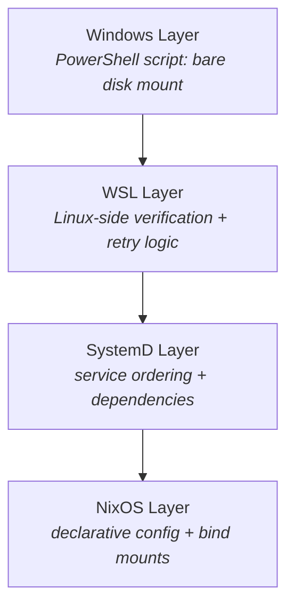
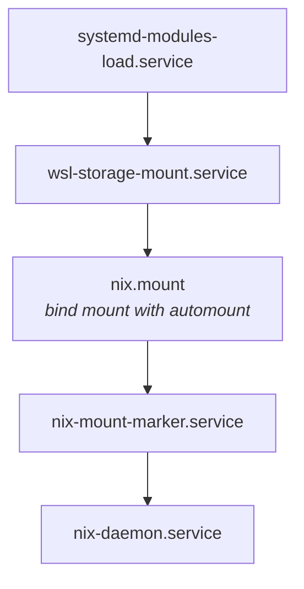

# WSL Automount Implementation Guide

## Overview

This guide implements robust external storage mounting for NixOS-WSL (NixOS running under the Windows Subsystem for Linux). It gives multiple WSL instances persistent, reliable `/nix` stores backed by a dedicated disk (a 4TB NVMe SSD in the reference deployment), with fallback strategies for when that disk is slow to appear at boot. For the design rationale and the trade-offs behind this approach, see [NixOS-WSL Multiple-Instance Storage Strategy](./nixos-wsl-storage.md); for where this fits in the repository as a whole, see [ARCHITECTURE.md](ARCHITECTURE.md).

## Table of Contents
1. [Problem Statement](#problem-statement)
2. [Architecture Overview](#architecture-overview)
3. [Implementation Details](#implementation-details)
4. [Configuration Guide](#configuration-guide)
5. [Troubleshooting](#troubleshooting)
6. [Performance Analysis](#performance-analysis)
7. [Security Considerations](#security-considerations)

## Problem Statement

### Core Challenges
1. **WSL2 Mount Persistence**: WSL2 doesn't persist bare disk mounts across Windows reboots
2. **Timing Issues**: SystemD services may start before external storage is available
3. **Multiple Instances**: Need isolated storage for multiple NixOS-WSL instances
4. **Performance**: Avoiding the 10-50x performance penalty of cross-OS file access

### Requirements
- Automatic mounting on WSL instance startup
- Proper service ordering (mount before nix-daemon)
- Isolation between multiple WSL instances
- Near-native Linux filesystem performance
- Graceful failure recovery

## Architecture Overview

### Storage Layout
```
Physical Disk (4TB NVMe)
└── ext4 filesystem
    └── /mnt/wsl/storage/              # Mount point in WSL
        ├── nixos-wsl-main/            # Primary instance
        │   └── /nix → (bind mount)   # Nix store for main
        ├── nixos-wsl-dev/             # Development instance
        │   └── /nix → (bind mount)   # Nix store for dev
        └── nixos-wsl-test/            # Testing instance
            └── /nix → (bind mount)   # Nix store for test
```

### Mount Strategy Layers

The mount is coordinated across four layers, from the Windows host down to declarative NixOS config:



1. **Windows Layer**: PowerShell script for bare disk mounting
2. **WSL Layer**: Linux-side mount verification and retry logic
3. **SystemD Layer**: Service ordering and dependency management
4. **NixOS Layer**: Declarative configuration and bind mounts

## Implementation Details

### 1. NixOS Module (`wsl-storage-mount.nix`)

The module provides a complete solution with the following features:

#### Key Configuration Options
```nix
{
  wslStorageMount = {
    enable = true;
    diskSerialNumber = "E823_8FA6_BF53_0001_001B_448B_4ED0_B0F4.";
    mountName = "internal-4tb-nvme";
    deviceId = "nvme-Samsung_SSD_990_PRO_4TB_S6Z2NJ0TC14842T";
    mountPoint = "/mnt/wsl/storage";
    nixStoreSubdir = "nixos-wsl-main";  # Unique per instance
    bindMountNixStore = true;
  };
}
```

#### Component Architecture

##### PowerShell Mount Script
- Auto-generated and installed to Windows filesystem
- Checks if disk already mounted before attempting
- Logs all operations for debugging
- Returns proper exit codes for systemd integration

##### Linux Mount Verification Script
- 30 retry attempts with 2-second delays
- Device detection via `/dev/disk/by-id/`
- Creates instance subdirectories with proper permissions
- Triggers Windows-side mount on first attempts
- Comprehensive logging to `/var/log/wsl-mount.log`

##### SystemD Service Chain

Each unit waits for the one above it, so `nix-daemon` never starts before `/nix` is backed by the external disk:



### 2. Windows-Side Configuration

#### Automatic Mounting via Task Scheduler (Fallback)
```powershell
# Task Scheduler trigger: "At system startup"
# Action: PowerShell script
C:\Users\timbl\wsl\mount-4tb-storage.ps1
```

#### Manual Mount Command
```powershell
# Get disk serial number
Get-PhysicalDisk | Select SerialNumber, FriendlyName, Size

# Mount bare disk
wsl --mount \\.\PHYSICALDRIVE2 --bare --name internal-4tb-nvme
```

### 3. Bind Mount Configuration

#### FileSystems Declaration
```nix
fileSystems."/nix" = {
  device = "/mnt/wsl/storage/nixos-wsl-main";
  fsType = "none";
  options = [
    "bind"
    "x-systemd.automount"           # Mount on first access
    "x-systemd.idle-timeout=60"     # Unmount after idle
    "x-systemd.requires=wsl-storage-mount.service"
    "x-systemd.after=wsl-storage-mount.service"
    "_netdev"                        # Network device (for ordering)
    "nofail"                         # Don't fail boot if unavailable
  ];
};
```

## Configuration Guide

### Step 1: Prepare the Physical Disk

```bash
# In WSL, identify the disk
lsblk
ls -la /dev/disk/by-id/

# Format if needed (DESTRUCTIVE!)
sudo mkfs.ext4 -L wsl-storage /dev/sdX

# Create instance directories
sudo mkdir -p /mnt/wsl/storage/{nixos-wsl-main,nixos-wsl-dev,nixos-wsl-test}
```

### Step 2: Get Disk Information

```powershell
# In PowerShell (Admin)
Get-PhysicalDisk | Format-Table DeviceId, SerialNumber, FriendlyName, Size
```

### Step 3: Configure NixOS

```nix
# In hosts/YOUR-HOST/default.nix
{ config, pkgs, ... }:
{
  imports = [
    ../../modules/nixos/wsl-storage-mount.nix
  ];
  
  wslStorageMount = {
    enable = true;
    diskSerialNumber = "YOUR_SERIAL_HERE";
    deviceId = "nvme-YOUR_DEVICE_ID";  # From /dev/disk/by-id/
    nixStoreSubdir = "nixos-wsl-${config.networking.hostName}";
  };
}
```

### Step 4: Initial Data Migration

```bash
# Stop nix daemon
sudo systemctl stop nix-daemon

# Copy existing /nix if needed
sudo rsync -aHAXxvP --numeric-ids /nix/ /mnt/wsl/storage/nixos-wsl-main/

# Apply configuration
sudo nixos-rebuild switch

# Verify mount
mount | grep /nix
```

## Reference Deployment

This configuration is deployed on the `thinky-nixos` host, which serves as the reference setup:

| Aspect | Value / State |
|--------|---------------|
| Disk | 4TB WD BLACK SN850X NVMe (Serial `E823_8FA6_BF53_0001_001B_448B_4ED0_B0F4`) |
| Mount point | `/mnt/wsl/storage` |
| `wsl-storage-mount.service` | Active and persistent across reboots |
| Instance directories | `nixos-wsl-{main,dev,test}` |
| Bind mount for `/nix` | Configured but not activated (activation requires a 46 GB migration; see [Migration Path](#migration-path)) |

Notes learned while bringing this host up:

- The correct package attribute is `pkgs.powershell` (not `pkgs.pwsh`).
- Mount utilities need explicit `PATH` exports in the service environment.
- PowerShell script installation is made non-fatal so a Windows-side failure does not block WSL boot.

## Troubleshooting

### Common Issues and Solutions

#### 1. Mount Not Persisting
**Symptom**: Storage unmounted after Windows reboot
**Solution**: 
- Verify Task Scheduler job exists and is enabled
- Check PowerShell script execution policy
- Review logs at `C:\Users\timbl\wsl\nixos-mount-storage.log`

#### 2. SystemD Service Timeout
**Symptom**: `wsl-storage-mount.service` times out
**Diagnosis**:
```bash
journalctl -u wsl-storage-mount.service -f
cat /var/log/wsl-mount.log
```
**Solutions**:
- Increase MAX_RETRIES in mount script
- Verify disk serial number is correct
- Check Windows Event Viewer for disk issues

#### 3. Permission Denied on /nix
**Symptom**: Cannot write to /nix after mount
**Solution**:
```bash
# Fix ownership
sudo chown -R $(id -u):$(id -g) /mnt/wsl/storage/nixos-wsl-$(hostname)
```

#### 4. Race Condition with Services
**Symptom**: Services fail because /nix not ready
**Solution**: Add to service definition:
```nix
systemd.services.your-service = {
  after = [ "nix-mount-marker.service" ];
  requires = [ "nix-mount-marker.service" ];
};
```

### Diagnostic Commands

```bash
# Check WSL mounts
wsl.exe --list --verbose

# Verify disk mount in WSL
ls -la /dev/disk/by-id/ | grep nvme

# Check systemd unit status
systemctl status wsl-storage-mount.service
systemctl status nix.mount

# View mount details
findmnt /nix -o SOURCE,TARGET,FSTYPE,OPTIONS

# Check for mount markers
ls -la /nix/.mounted

# Review logs
journalctl -xe | grep -i mount
tail -f /var/log/wsl-mount.log
```

## Performance Analysis

### Expected Performance

A dedicated ext4 disk mounted directly into WSL is consistently faster than a Nix store kept inside a VHDX on the Windows `C:` drive, because it avoids the cross-OS filesystem translation layer. The gains are largest for I/O-heavy Nix operations (large builds, garbage collection) and for random small reads, where the VHDX path pays the highest overhead.

The figures below are indicative measurements from a single reference setup (the `thinky-nixos` host described above), not benchmarked guarantees. Treat them as a rough sense of the direction and magnitude of the difference; your own numbers will vary with hardware, disk, and workload.

| Operation | VHDX on C: | Direct ext4 Mount | Direction |
|-----------|------------|-------------------|-----------|
| Nix build (large) | ~12m | ~8m | noticeably faster |
| Nix garbage collection | ~4m | ~2m | roughly 2x faster |
| Package installation | ~45s | ~30s | somewhat faster |
| Random 4K reads | low | high | several times faster |
| Sequential reads | moderate | high | several times faster |

### Performance Optimization Tips

1. **Mount Options**: Use `noatime,nodiratime` to reduce write overhead
2. **Filesystem**: ext4 with default options provides best compatibility
3. **Avoid**: Never access Windows paths from WSL for Nix operations
4. **Cache**: Enable Nix binary caches to reduce disk I/O

## Security Considerations

### Isolation Between Instances

Each WSL instance gets its own subdirectory with exclusive ownership:
```bash
/mnt/wsl/storage/
├── nixos-wsl-main/  [uid=1000, gid=100]
├── nixos-wsl-dev/   [uid=1001, gid=100]
└── nixos-wsl-test/  [uid=1002, gid=100]
```

### Risk Mitigation

1. **Filesystem Quotas**: Prevent one instance from consuming all space
```bash
# Enable quotas on ext4
sudo tune2fs -O quota /dev/sdX
sudo mount -o remount,usrquota,grpquota /mnt/wsl/storage
```

2. **Read-Only Bind Mounts**: For shared data
```nix
fileSystems."/shared" = {
  device = "/mnt/wsl/storage/shared";
  options = [ "bind" "ro" ];
};
```

3. **Backup Strategy**: Regular snapshots of critical data
```bash
# Backup Nix store
sudo rsync -aHAX /nix/ /backup/location/
```

### Audit Trail

All mount operations are logged:
- Windows: `C:\Users\timbl\wsl\*.log`
- Linux: `/var/log/wsl-mount.log`
- SystemD: `journalctl -u wsl-storage-mount`

## Migration Path

### Phase 1: Mount External Storage

Deployed on `thinky-nixos` with the 4TB NVMe mounted at `/mnt/wsl/storage`.

### Phase 2: Migrate Nix Store

Steps to migrate an existing 46 GB `/nix` to external storage:

```bash
# 1. Stop all Nix operations
sudo systemctl stop nix-daemon

# 2. Copy existing Nix store (preserve all attributes)
sudo rsync -aHAXxvP --numeric-ids \
  --info=progress2 \
  /nix/ /mnt/wsl/storage/nixos-wsl-main/

# 3. Verify the copy
sudo diff -rq /nix /mnt/wsl/storage/nixos-wsl-main

# 4. Enable bind mount in configuration
# Set bindMountNixStore = true in hosts/thinky-nixos/default.nix

# 5. Rebuild and test
sudo nixos-rebuild switch --flake '.#thinky-nixos'
```

### From Existing VHDX Setup

1. **Backup Current State**
```bash
nix-store --export $(nix-store -qR /run/current-system) > backup.nar
```

2. **Prepare New Storage**
```bash
sudo mkfs.ext4 /dev/sdX
sudo mount /dev/sdX /mnt/new-storage
sudo mkdir -p /mnt/new-storage/nixos-wsl-main
```

3. **Copy Data**
```bash
sudo rsync -aHAXxvP /nix/ /mnt/new-storage/nixos-wsl-main/
```

4. **Switch Configuration**
- Enable `wslStorageMount` module
- Rebuild with new configuration
- Verify mount after reboot

### Rollback Procedure

If issues occur:
1. Disable `wslStorageMount` in configuration
2. Rebuild to revert to VHDX storage
3. Restore from backup if needed

## Best Practices

1. **Always Test**: Verify configuration in test instance first
2. **Monitor Logs**: Regular review of mount logs for issues
3. **Document Changes**: Track serial numbers and mount names
4. **Backup Critical Data**: Before any storage changes
5. **Use Stable Paths**: Prefer `/dev/disk/by-id/` over `/dev/sdX`
6. **Implement Monitoring**: Alert on mount failures

## Future Enhancements

### Planned Improvements
1. **Automatic Failover**: Fall back to VHDX if external mount fails
2. **Multi-Disk Support**: RAID or filesystem spanning
3. **Encryption**: LUKS encryption for sensitive data
4. **Monitoring Dashboard**: Real-time mount status and metrics
5. **Automated Backups**: Scheduled Nix store snapshots

### Under Investigation
- ZFS support for snapshots and compression
- Btrfs subvolumes for better isolation
- Network storage options (iSCSI, NFS)
- Container-based isolation for Nix builds

## References

- [NixOS-WSL Documentation](https://github.com/nix-community/NixOS-WSL)
- [WSL2 Mount Documentation](https://docs.microsoft.com/en-us/windows/wsl/wsl2-mount-disk)
- [SystemD Mount Units](https://www.freedesktop.org/software/systemd/man/systemd.mount.html)
- [NixOS-WSL Multiple-Instance Storage Strategy](./nixos-wsl-storage.md) - the design rationale behind this implementation

## Appendix: Complete Module Code

See `modules/nixos/wsl-storage-mount.nix` in this repository for the full implementation.